# Task 1: Secure Linux Bastion Host and Process Management

**Elevvo Cloud and DevOps Engineering Internship**  
**Author:** Dorcas Torshie Sai  
**Date completed:** October 2026

## 1. Introduction

A bastion host is a hardened server that serves as the controlled entry point into a network. Because it is the machine most exposed to attack, its configuration matters more than that of almost any other system. This report documents how I built a small bastion host on an Ubuntu virtual machine for Task 1 of the Elevvo Cloud and DevOps Engineering Internship.

The work had three parts. First, I handled the machine entirely from the terminal. Second, I replaced password-based SSH access with key-based authentication and disabled root login. Third, I deployed a simple web service under systemd, so that I could control its lifecycle and make sure it starts at boot. A bonus exercise asked me to restrict SSH to a private network interface, which I completed using Tailscale. The original brief is reproduced in Figure 1.

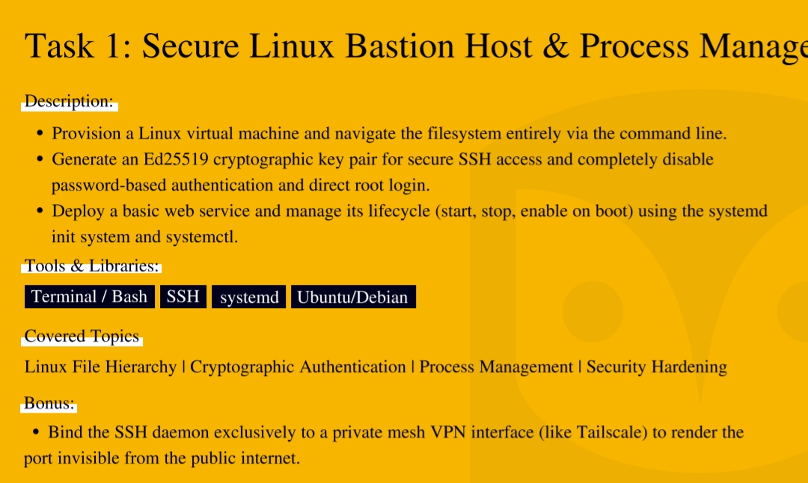

*Figure 1: The task brief*

## 2. Objectives

The brief set the following objectives:

- Provision a Linux virtual machine and navigate the filesystem using only the command line
- Generate an Ed25519 key pair for SSH access, and disable both password authentication and direct root login
- Deploy a basic web service and manage its lifecycle (start, stop and enable on boot) with systemd and `systemctl`
- **Bonus:** bind the SSH daemon to a private mesh VPN interface such as Tailscale, so that the port is invisible from the public internet

## 3. Environment

All work was carried out on an Ubuntu virtual machine running in Oracle VirtualBox. The tools involved are summarised below.

| Item | Detail |
|---|---|
| Operating system | Ubuntu 26.04.1 LTS on an Oracle VirtualBox virtual machine |
| Shell | Bash |
| SSH server | OpenSSH (`sshd`) |
| Init system | systemd |
| Web service | Python 3 `http.server`, listening on port 8000 |
| Private network (bonus) | Tailscale |

## 4. Implementation

### Step 1: Filesystem navigation

**Description**

This step was about learning to work without a graphical interface. I created a folder for the project, confirmed my location, listed its contents and then explored `/etc`, the directory in which Linux stores its system-wide configuration files. I finished by checking my username and the name of the machine.

**Commands used and explanation**

| Command | What it does |
|---|---|
| `mkdir -p ~/elevvo/Task1-Secure-Bastion-Host/configs` | Creates the project folder and its `configs` subfolder in one go. The `-p` option creates any missing parent folders and does not complain if they already exist. |
| `cd ~/elevvo/Task1-Secure-Bastion-Host` | Moves into the project folder. |
| `pwd` | Prints the full path of the current directory, so I can confirm where I am. |
| `ls -la` | Lists everything in the directory, including hidden files, with permissions, owners and sizes. |
| `cd /etc && pwd && ls \| head -20` | Moves to `/etc`, prints the path and shows the first twenty entries. The `head -20` part keeps the output short. |
| `cd ~` | Returns to my home directory. |
| `whoami` | Shows which user I am logged in as. |
| `hostname` | Shows the name of the machine. |

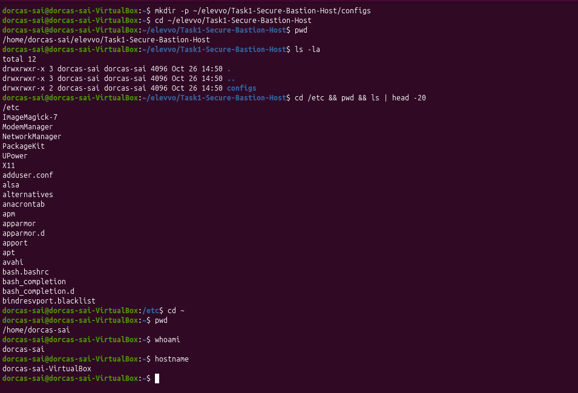

*Figure 2: Navigating the filesystem from the terminal*

**Notes**

It is worth knowing where `/etc` is early on, because the SSH and systemd settings changed later in this task are stored there. Every action in the task was typed at the terminal.

### Step 2: Generating an Ed25519 key pair

**Description**

Key-based authentication replaces a password with a pair of cryptographic keys. The private key stays on my machine, and the public key is placed on the server, which can then check that a connecting user holds the matching private key. I generated the pair with the Ed25519 algorithm, which gives strong security with short keys and fast operations.

**Commands used and explanation**

| Command | What it does |
|---|---|
| `mkdir -p ~/.ssh` | Creates the folder where SSH keeps keys, if it does not already exist. |
| `chmod 700 ~/.ssh` | Allows only the owner to read, write or enter the folder. |
| `ssh-keygen -t ed25519 -C "elevvo-bastion-key" -f ~/.ssh/bastion_key -N ""` | Generates the key pair. `-t` chooses the algorithm, `-C` adds a label, `-f` sets the file name and `-N ""` sets an empty passphrase. |
| `chmod 600 ~/.ssh/bastion_key` | Makes the private key readable and writable by its owner only. |
| `chmod 644 ~/.ssh/bastion_key.pub` | Lets others read the public key, which is safe to share. |
| `ls -l ~/.ssh/` | Lists the folder with permissions, to check the settings above. |
| `cat ~/.ssh/bastion_key.pub` | Displays the public key. |

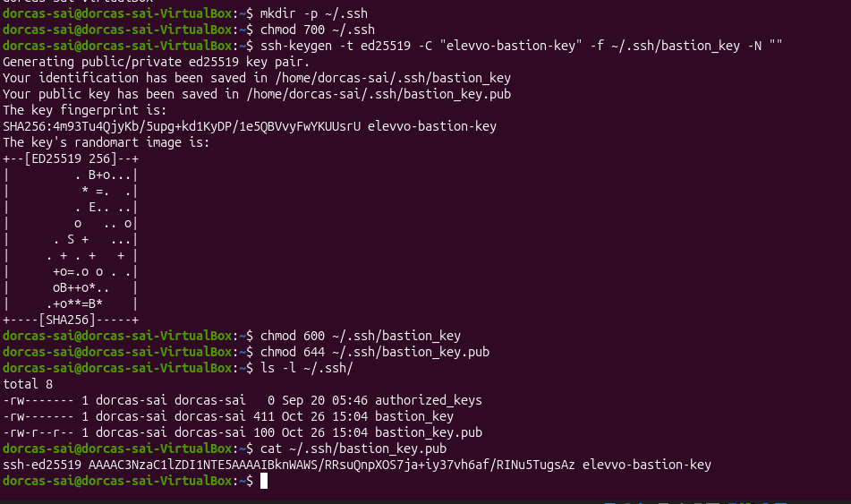

*Figure 3: The Ed25519 key pair and its permissions*

**Notes**

SSH ignores keys that are stored where other users can reach them, which is why the permissions matter: `700` for the folder, `600` for the private key and `644` for the public key. I used an empty passphrase because this is a laboratory exercise. A production key should have a passphrase and be loaded through `ssh-agent`. The private key was never shared or uploaded to GitHub.

### Step 3: Hardening SSH

**Description**

With the key pair ready, I hardened the SSH daemon. Before changing anything I saved a copy of the original configuration file, so that I could restore it if a mistake locked me out. I then edited three directives in `/etc/ssh/sshd_config`, tested the file and restarted the service.

**Commands used and explanation**

| Command | What it does |
|---|---|
| `sudo cp /etc/ssh/sshd_config ./configs/sshd_config.backup` | Copies the original configuration into the project folder as a backup. `sudo` is needed to read the system file. |
| `sudo nano /etc/ssh/sshd_config` | Opens the SSH configuration in a text editor with administrator rights. |
| `sudo sshd -t` | Tests the configuration for errors without applying it. Silence means the file is valid. |
| `sudo systemctl restart sshd` | Restarts the SSH service so that the new settings take effect. |
| `sudo systemctl status sshd --no-pager` | Shows whether the service is running. `--no-pager` prints everything at once instead of opening a scrolling view. |

The three directives I set were the following.

| Directive | Effect |
|---|---|
| `PermitRootLogin no` | Stops anyone from logging in directly as root, so an attacker must first identify a valid user account. |
| `PubkeyAuthentication yes` | Allows the key pair from Step 2 to be used for login. |
| `PasswordAuthentication no` | Removes password guessing from the attack surface altogether, because a server that does not accept passwords cannot be brute-forced through them. |

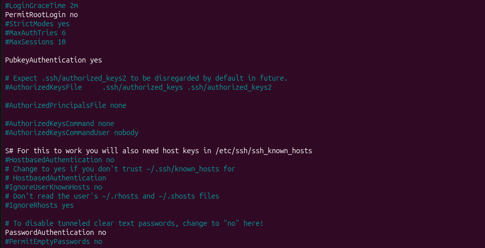

*Figure 4: The hardened settings in sshd_config*

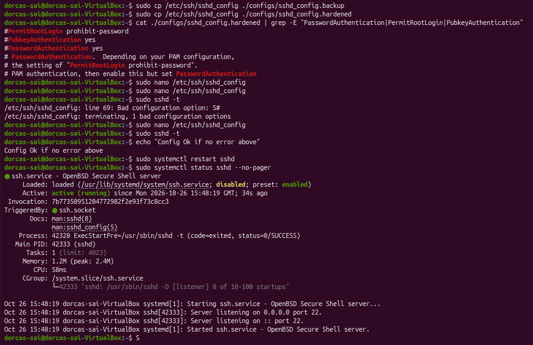

*Figure 5: The configuration validated and sshd restarted*

**Notes**

Testing with `sshd -t` before restarting is important, because a syntax error in this file can stop the service from starting and leave no way to log in remotely. The test returned no errors, and the status output shows the service as active (running). The public key also has to be listed in `~/.ssh/authorized_keys` before the server will accept it, and I added it and tested the result in Section 6. At the end of the task I saved a copy of the finished configuration as `configs/sshd_config.hardened`.

### Step 4: Deploying a web service with systemd

#### 4.1 Creating and starting the service

**Description**

To practise process management, I put a small web service under the control of systemd. A page called `index.html` is stored in `/opt/myweb` and served by Python's built-in HTTP server on port 8000. A unit file tells systemd how to run it. The file below is installed as `/etc/systemd/system/myweb.service`.

```ini
[Unit]
Description=Elevvo Task 1 Web Service
After=network.target

[Service]
Type=simple
User=www-data
WorkingDirectory=/opt/myweb
ExecStart=/usr/bin/python3 -m http.server 8000 --directory /opt/myweb
Restart=always
RestartSec=5

[Install]
WantedBy=multi-user.target
```

| Directive | Meaning |
|---|---|
| `Description` | A human-readable name that appears in status output. |
| `After=network.target` | Starts the service only once the network is available. |
| `Type=simple` | Treats the command in `ExecStart` as the main process. |
| `User=www-data` | Runs the service as an unprivileged account instead of root, which limits the damage if the service were ever compromised. |
| `WorkingDirectory` | Sets the folder the process starts in. |
| `ExecStart` | The command that runs the service: Python's web server on port 8000, serving `/opt/myweb`. |
| `Restart=always` and `RestartSec=5` | Start the process again, after five seconds, if it stops unexpectedly. |
| `WantedBy=multi-user.target` | Makes the service start automatically at boot once it has been enabled. |

**Commands used and explanation**

| Command | What it does |
|---|---|
| `sudo mkdir -p /opt/myweb` | Creates the folder that holds the web page. |
| `ls -l /opt/myweb` | Confirms that `index.html` is in the folder. |
| `sudo tee /etc/systemd/system/myweb.service > /dev/null <<'EOF'` | Writes the text that follows, up to the line `EOF`, into the unit file. `tee` is used because a plain redirect would not carry administrator rights, and `> /dev/null` hides the echo of the text on screen. |
| `cat /etc/systemd/system/myweb.service` | Displays the file to check what was written. |
| `sudo systemctl daemon-reload` | Makes systemd read the new unit file. |
| `sudo systemctl enable myweb.service` | Sets the service to start at boot. |
| `sudo systemctl start myweb.service` | Starts the service now. |
| `sudo systemctl status myweb.service --no-pager` | Shows whether the service is running and its recent log lines. |

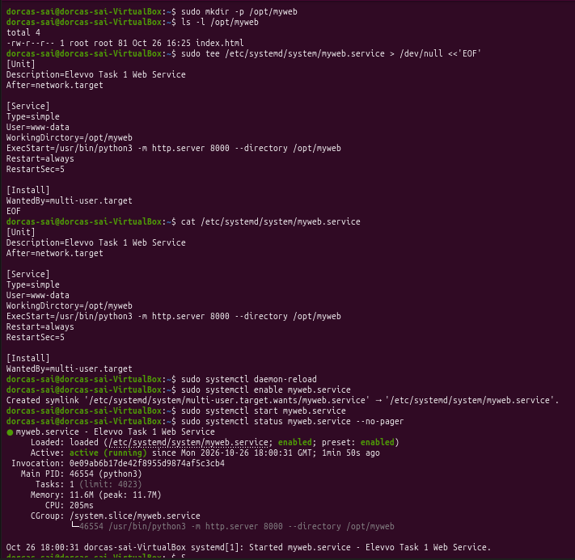

*Figure 6: Creating, enabling and starting the service (the first version of the unit file, before a typo in the WorkingDirectory line was corrected)*

**Notes**

The status output shows the service as `enabled` and `active (running)`. This first version of the unit file contained a typo, which I describe and correct in section 4.4.

#### 4.2 Stopping, starting and testing

**Description**

Next I tested the lifecycle of the service. I stopped it, checked its state, started it again and confirmed that it is enabled for boot. I also made a request to the page. The `curl` utility was missing from the machine, so I installed it first.

**Commands used and explanation**

| Command | What it does |
|---|---|
| `sudo systemctl stop myweb` | Stops the running service. |
| `sudo systemctl status myweb --no-pager \| head -10` | Shows the first ten lines of the status, which is enough to see the state. |
| `sudo systemctl start myweb` | Starts the service again. |
| `sudo systemctl is-enabled myweb` | Reports whether the service is set to start at boot. |
| `sudo apt install curl` | Installs `curl`, a tool for making web requests from the terminal. |
| `curl http://localhost:8000` | Requests the page from the local machine. |

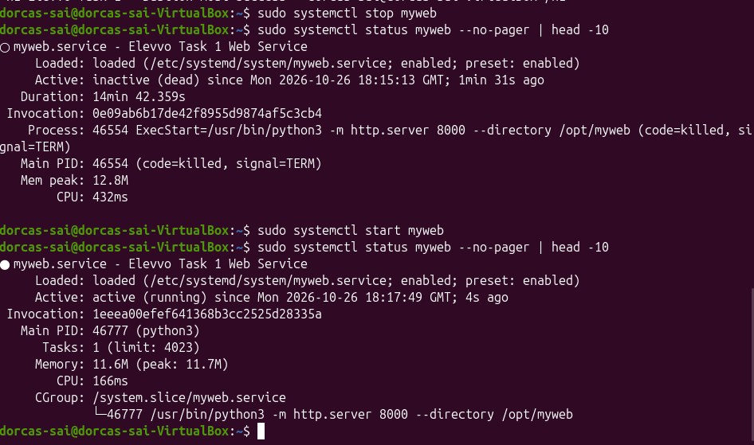

*Figure 7: Stopping and starting the service*

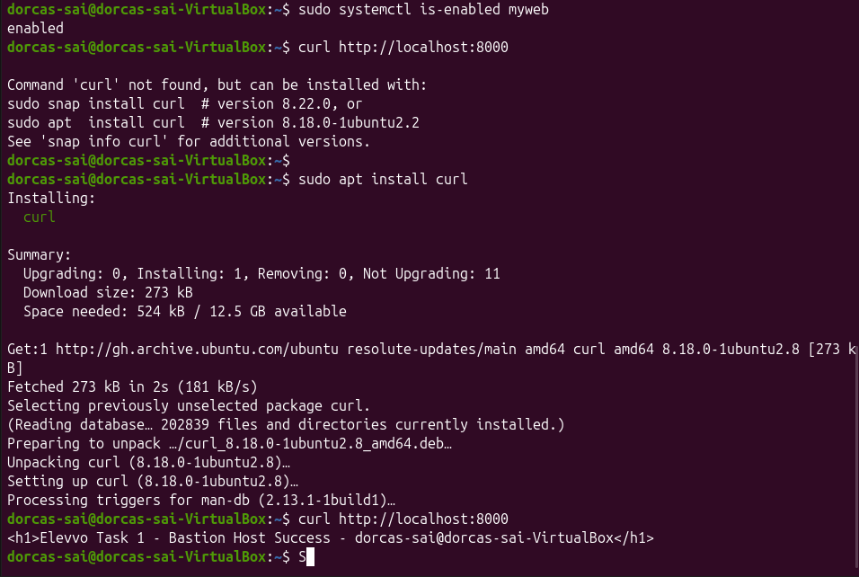

*Figure 8: The service is enabled and responds to curl*

**Notes**

After the service was stopped, the status read `inactive (dead)`. After it was started again a new process ID appeared (46554 became 46777), which shows that systemd launched a fresh process. The `is-enabled` command returned `enabled`. I did not restart the whole virtual machine to watch the service come up by itself, so that part rests on the `enabled` status.

#### 4.3 Recording the setup

**Description**

To leave a record next to the service, I wrote a short README file inside `/opt/myweb` that lists the service file, its status and the test command.

**Commands used and explanation**

| Command | What it does |
|---|---|
| `echo "# Elevvo Task 1 - Dorcas Torshie Sai" \| sudo tee /opt/myweb/README.md` | Writes the first line of the file, creating it. `sudo` is needed because the folder belongs to root. |
| `echo "..." \| sudo tee -a /opt/myweb/README.md` | Adds each further line. The `-a` option appends instead of overwriting. |
| `cat /opt/myweb/README.md` | Displays the finished file. |
| `ls -lh /opt/myweb/` | Lists the folder with sizes in a readable form. |

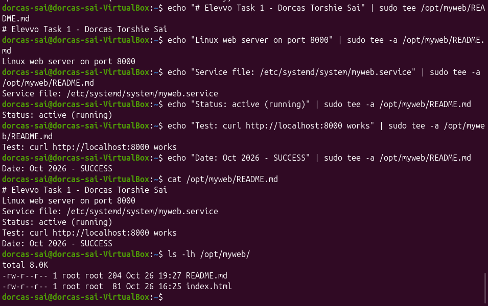

*Figure 9: The service README stored on the virtual machine*

#### 4.4 Correcting the unit file

**Description**

While reviewing the unit file, I noticed that I had written `WorkingDirctory` instead of `WorkingDirectory`. I opened the file, corrected the spelling, reloaded systemd and restarted the service to confirm that it still worked.

**Commands used and explanation**

| Command | What it does |
|---|---|
| `sudo nano /etc/systemd/system/myweb.service` | Opens the unit file for editing. |
| `sudo systemctl daemon-reload` | Makes systemd read the corrected file. |
| `sudo systemctl restart myweb` | Stops and starts the service in one step. |
| `sudo systemctl status myweb --no-pager \| head -10` | Checks that the service is running. |
| `curl http://localhost:8000` | Confirms that the page is still served. |

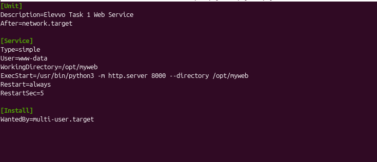

*Figure 10: The corrected unit file*

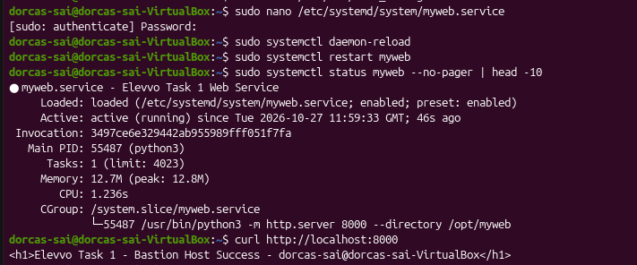

*Figure 11: The service running after the correction, and the page still served*

**Notes**

Systemd silently ignores directives it does not recognise. The service had therefore kept working only because the `ExecStart` line already passed `--directory /opt/myweb`. After the correction it restarted normally and served the page as before. The lesson was that a service can look healthy while still being misconfigured.

## 5. Bonus: Restricting SSH to a Private Interface

**Description**

The bonus exercise asked me to make SSH invisible to the public internet. My approach was to make the daemon listen only on the private address that a mesh VPN assigns to the machine. I installed Tailscale, joined the machine to my own network, obtained its private address and then told `sshd` to listen only on that address and on the loopback interface. Because SSH on this Ubuntu release is started through a systemd socket, I also reloaded systemd and restarted the socket.

**Commands used and explanation**

| Command | What it does |
|---|---|
| `sudo tailscale up` | Connects the machine to my Tailscale network after I signed in through the link it printed. |
| `tailscale ip -4` | Shows the machine's private IPv4 address on that network (`100.88.63.99`). |
| `sudo nano /etc/ssh/sshd_config` | Opens the SSH configuration to add the two `ListenAddress` lines. |
| `sudo sshd -t` | Tests the edited file before it is applied. |
| `sudo systemctl daemon-reload` | Makes systemd read the changed configuration. |
| `sudo systemctl restart ssh.socket` | Restarts the socket through which SSH is started. |
| `sudo systemctl restart ssh` | Restarts the SSH service itself. |
| `sudo ss -tulnp \| grep :22` | Lists listening network sockets and keeps only those on port 22, to show where SSH is reachable. |

The two lines added to `sshd_config` were:

```text
ListenAddress 100.88.63.99
ListenAddress 127.0.0.1
```

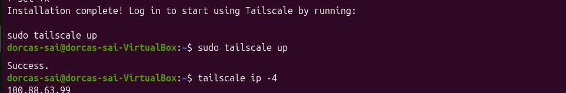

*Figure 12: The private Tailscale address of the virtual machine*


*Figure 13: The ListenAddress directives*

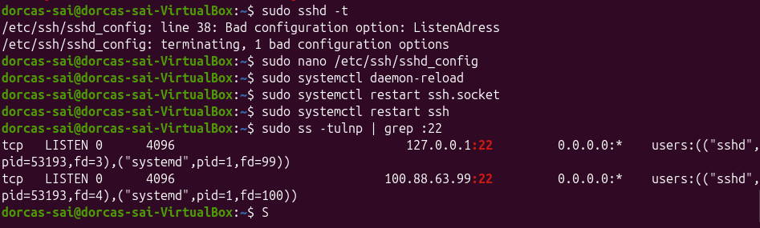

*Figure 14: SSH bound to the loopback and Tailscale addresses only*

**Notes**

The final command showed SSH listening on `127.0.0.1:22` and `100.88.63.99:22` and no longer on `0.0.0.0`, so the service cannot be reached from the public network. Tailscale assigns private addresses that are not routable on the public internet. The one-time sign-in link that Tailscale prints has been removed from Figure 12, because anyone holding it could attach a device to my network.

## 6. Verification of Key-Based Login

**Description**

With password login disabled, the server needs my public key in its list of authorised keys. I added the key and then tested two things: that a login with the key succeeds, and that a login without the key is refused. Because SSH now listens only on the loopback and Tailscale addresses, I ran both tests against the loopback address of the same machine.

**Commands used and explanation**

| Command | What it does |
|---|---|
| `cat ~/.ssh/bastion_key.pub >> ~/.ssh/authorized_keys` | Appends the public key to the list of keys allowed to log in. `>>` adds to the file instead of replacing it. |
| `chmod 600 ~/.ssh/authorized_keys` | Restricts the file to its owner, as SSH requires. |
| `rm ~/.ssh/authorised_keys` | Deletes a misspelled file that my first attempt had created (see Challenges). |
| `ls -l ~/.ssh/` | Lists the folder to confirm the correct file and its permissions. |
| `ssh -i ~/.ssh/bastion_key dorcas-sai@127.0.0.1` | Logs in with the private key. `-i` names the key file to use. |
| `ssh -o PubkeyAuthentication=no dorcas-sai@127.0.0.1` | Tries to log in with key authentication switched off, to see whether a password would be accepted. |

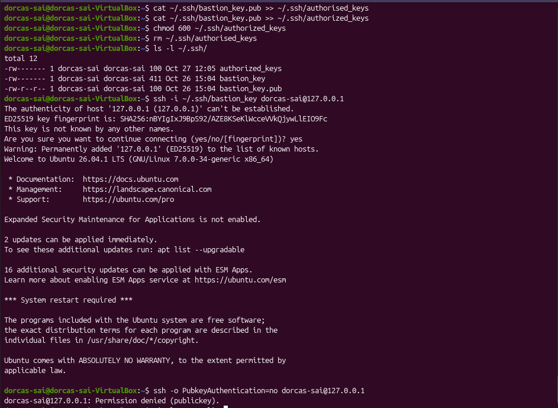

*Figure 15: Key-based login succeeds and a login without the key is refused*

**Notes**

The first connection asked me to accept the host fingerprint, and I answered `yes`. The key login then opened a session without asking for a password, and the attempt without the key ended with `Permission denied (publickey)`. That message lists `publickey` as the only accepted method, which confirms that password authentication is off. The directory listing in the figure also shows the effect of my earlier spelling mistake, described in Section 8.

## 7. Results

All of the requirements in the brief were met, including the bonus. The table below links each requirement to the figure that shows it.

| Requirement | Outcome | Evidence |
|---|---|---|
| Navigate the filesystem from the command line | Completed | Figure 2 |
| Ed25519 key pair created with correct permissions | Completed | Figure 3 |
| Root login disabled | Completed | Figure 4 |
| Password authentication disabled | Completed | Figures 4 and 15 |
| SSH configuration validated and service running | Completed | Figure 5 |
| Key-based login works | Completed | Figure 15 |
| Web service deployed with systemd | Completed | Figure 6 |
| Service stopped and started with `systemctl` | Completed | Figure 7 |
| Service enabled on boot and responding to requests | Completed | Figure 8 |
| Unit file corrected and service re-tested | Completed | Figures 10 and 11 |
| Bonus: SSH restricted to the private interface | Completed | Figures 12 to 14 |

One limitation should be stated plainly. I confirmed that the web service is enabled for boot, but I did not restart the virtual machine to watch it come up on its own.

## 8. Challenges Encountered

Several errors occurred along the way, and each taught me something about how these tools behave.

| Problem | Cause | Resolution |
|---|---|---|
| `Bad configuration option: ListenAdress` | I misspelled the directive in `sshd_config` during the bonus exercise. | Corrected it to `ListenAddress`. Running `sshd -t` caught the error on line 38 before anything was restarted. |
| `Bad configuration option: S#` on line 69 | A stray character had been typed at the start of a comment line in `sshd_config`. | Removed the extra character and repeated `sshd -t` until it passed. |
| `curl: command not found` | `curl` was not installed on the machine. | Installed it with `sudo apt install curl`. |
| `WorkingDirctory` in the unit file | A spelling mistake in the directive name. Systemd ignored it without any warning. | Corrected the spelling, reloaded systemd and restarted the service (section 4.4). |
| Key login would not have worked: `authorised_keys` | I used the British spelling of the file name. SSH only reads `authorized_keys`, spelled with a z. | Appended the key to `authorized_keys`, set its permissions and deleted the misspelled file (Section 6). |

The common thread is that Linux tools do exactly what they are told, including when the instruction contains a typo. Testing each change, rather than assuming it worked, caught most of these problems early.

## 9. Conclusion

This task changed the way I think about securing a server. Each control removes a particular route of attack: direct root login, password guessing, public exposure of the SSH port, and a service running with more privilege than it needs. I also picked up practical habits that I expect to keep, such as backing up a configuration file before editing it and validating a change before applying it.

If I extended this work, I would protect the key with a passphrase, add `fail2ban` and a firewall such as `ufw`, place the web service behind Nginx with HTTPS, restart the machine to confirm the boot behaviour, and automate the whole setup with a Bash script.

